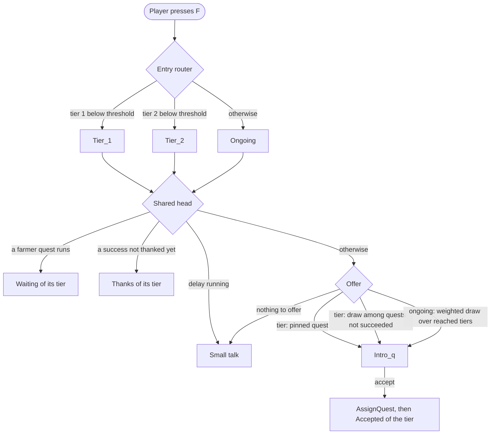

# Tiered character stories

A pattern for AdventureQuests characters with a job or a function (farmer, merchant, chief) whose
story grows over several quests, while every village and camp keeps its one-off characters. The
Kweebec farmer (`AdventureQuests_KweebecFarmer`) is the worked example.

## Goal

- Every village or camp still offers small stories to discover, as today.
- A few characters with a job get depth: quests in tiers sorted by difficulty and reward rarity,
  several quests per tier, a real-time delay between offers, thanks that quote what the player did.
- Once the last tier is passed the relationship goes on: the character keeps offering quests from
  the tiers reached.
- Many NPCs carry the same job character, each living its own story with each player: two farmers
  can offer the same quest, each to be done for that farmer.

## The NPC is the unit of story

- One character asset per job, `Uniqueness: None`, a `Name` trait drawing a name per NPC, a
  `Dialogue` trait on the job's entry router. No per-NPC copy of dialogues, routers or quests.
- Every history condition reads the speaking NPC alone: `Opened`, `Answered`, `OpenedAfter` and
  `Cooldown` with `With: Npc`.
- Every quest condition reads the quests that NPC gave: `RequiresQuest` and `QuestCooldown` with
  `GivenBy: Npc`. `AssignQuest` writes the giver on the quest, so this needs nothing else.
- Every quest aims at its giver: `NearCharacter` constraints, `Deliver` and `Dialogue` quests with
  `Target: GiverNpc`.
- Quest texts name the giver: titles use `{giver}`, filled with the name the NPC carries.
- When the NPC is released (death, removal, revocation), its running quests aimed at it fail and
  its history and giver record move under the character's unknown-NPC key: `With: Npc` and
  `GivenBy: Npc` start afresh for an NPC drawing the character later, `Character` counts keep them.
- Distribution: one entry, a `Priority` above the one-off characters of the same race so the job
  is drawn first, the job's role, no instance (`World` `instance-.*` with `Not: true`), and a
  `NearCharacter` filter with `Not: true` on the job itself, so each village gets exactly one.

```json
{ "Type": "NearCharacter", "Characters": ["AdventureQuests_KweebecFarmer"], "Radius": 64, "Not": true }
```

## Tiers and thresholds

- Every tier needs at least as many quests that can always be offered as its threshold. A quest
  gated by the world (ripe crops, a nearby block) only adds variety: in a village lacking it, the
  tier would otherwise never open the next one.

- Each tier lists its quests. Its threshold is `min(2, quests in the tier)`: a tier released with
  one quest opens the next one after that quest, and the batch adding its second quest raises it.
- A tier counts its successes for this NPC with one `RequiresQuest` over the whole list
  (`QuestAssetIds`, `Successful`, `GivenBy: Npc`). The draw of a tier never offers a quest already
  succeeded there, so every counted success is a different quest.

## Dialogue kinds

| Kind | Count | Role |
|---|---|---|
| Entry router | 1 | Bound through the `Dialogue` trait. Finds the current tier, hands over to its router. |
| Tier router | 1 per tier | Shared head, then the tier's offer. |
| Ongoing router | 1 | Shared head, then a draw over every tier reached. |
| Quest intro | 1 per quest | Offers one quest. Inside a tier, its first opening pins that quest until it succeeds. |
| Accepted dialogue | 1 per tier | Opened by the intro's accept answer (`AssignQuest`, then `Open`). Starts the delay. |
| Waiting, thanks | 1 per tier | Quote the tier's work (the harvest, the planting). |
| Small talk | 1 | During the delay, or when nothing can be offered. |

## Entry router

A `Sequence`, lowest tier first, so the route order makes the progression cumulative:

1. Fewer successes than its threshold in tier 1 (`Min: 0`, `Max: threshold - 1`): router `Tier_1`.
2. The same for tier 2: router `Tier_2`.
3. ...
4. Fallback: router `Ongoing`.

Raising a threshold sends players already above back to that tier to discover its new quest; one
success brings them straight back up, since the higher tiers still hold.

## Shared head of every tier router

1. **Waiting**: one route per tier, highest first, `RequiresQuest` `InProgress` over the tier's
   list: that tier's `Waiting`. Every router covers every tier, for a player sent back by a raised
   threshold while a higher quest runs.
2. **Thanks**, one route per quest `q`: `q` succeeded at least once, and both `Intro_q` and the
   tier's `Accepted` dialogue were opened after the tier's `Thanks` (`OpenedAfter`): `Thanks_T`.
   A failed or declined quest is never thanked.
3. **Delay**: `Cooldown` 1200 s on any tier's `Accepted` dialogue, `Not: true`: small talk.

## Tier offer

1. **Pinned quest**: per quest `q`, `Opened` `Intro_q` and `q` neither running nor succeeded:
   `Intro_q`. A declined or failed quest is offered again.
2. **Draw**: `Weighted` among the tier's quests neither running nor succeeded. No fallback to the
   whole tier: the threshold is met before the tier runs out.
3. Fallback: small talk.

## Ongoing offer

No pin. A `Weighted` draw among the quests of every tier reached, each not running, weighted
toward the highest tier. Fallback: small talk.



## Farmer example

- **Tier 1, a helping hand** (threshold 2): a `Weighted` draw among two tool quests, always
  offered (`Deliver` to `GiverNpc`: 4 logs and 3 stones for a hoe, 3 wood and 1 iron bar for a
  bucket), and the aubergine and pumpkin harvests, offered only when their crop is ripe around the
  player (`NearBlock` `StageFinal`, 2 within 30 blocks).
- **Tier 2, planting** (threshold 2): a `Weighted` draw among potato, onion and cauliflower planting
  (`PlaceBlock` near the giver, seeds handed with the quest).
- **Ongoing**: the tier 1 harvests weigh 1 (still only with ripe crops), tier 2 quests weigh 2.
  The tool quests are not offered again: the farmer has his tools.
- A new tier adds its router, one entry route, its waiting and thanks routes in the shared head,
  and its quests to the ongoing draw.

## Limits

- In the ongoing phase a quest succeeded long ago, offered again, accepted and failed, is thanked:
  `OpenedAfter` cannot tell this success from the earlier one.
- A pinned intro stays pinned even when what it asks for vanished (the crops were picked by
  someone else): the player waits for them to grow again.
- Each tier's threshold is written by hand in the entry router.
