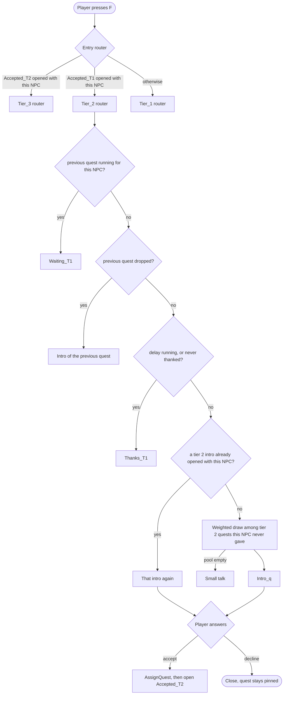

# Tiered character stories

A pattern for AdventureQuests characters with a job or a function (farmer, merchant, chief) whose
story grows over several quests, while every village and camp keeps its one-off characters. The
Kweebec farmer (`AdventureQuests_KweebecFarmer`) is the worked example.

## Goal

- Every village or camp still offers small stories to discover, as today.
- A few characters with a job get depth: quests in tiers, each tier offered after the previous one
  and a real-time delay, with thanks in between that quote what the player did.
- Many NPCs carry the same job character, each living its own story with each player: two farmers
  can offer the same quest, each to be done for that farmer.

## The NPC is the unit of story

- One character asset per job, `Uniqueness: None`, a `Name` trait drawing a name per NPC, a
  `Dialogue` trait on the job's entry router. No per-NPC copy of dialogues, routers or quests.
- Every history condition reads the speaking NPC alone: `Opened`, `Answered` and `Cooldown` with
  `With: Npc`.
- Every quest condition reads the quests that NPC gave: `RequiresQuest` and `QuestCooldown` with
  `GivenBy: Npc`. `AssignQuest` writes the giver on the quest, so this needs nothing else.
- Every quest aims at its giver: `NearCharacter` constraints, `Deliver` and `Dialogue` quests with
  `Target: GiverNpc`.
- Quest texts name the giver: titles use `{giver}`, and the asset declares a fallback for a giver
  with no drawn name, `"Tags": {"Text.giver": ["<pack>.<file>.farmer.someone"]}`.
- When the NPC is released (death, removal, revocation), its running quests aimed at it fail and
  its history leaves the players' saves: an NPC drawing the character later starts afresh.
- Distribution: the job's role, no instance (`World` `instance-.*` with `Not: true`), and a
  `NearCharacter` filter with `Not: true` listing the job and the one-off characters of the same
  theme, so one village gets at most one of them.

```json
{ "Type": "NearCharacter", "Characters": ["AdventureQuests_KweebecFarmer"], "Radius": 64, "Not": true }
```

## Dialogue kinds

| Kind | Count | Role |
|---|---|---|
| Entry router | 1 | Bound through the `Dialogue` trait. Finds the current tier, hands over to its router. |
| Tier router | 1 per tier, plus 1 after the last | Waiting, dropped quest, thanks, then the tier's quest. |
| Quest intro | 1 per quest | Offers one quest. Its first opening with an NPC pins that quest for that NPC. |
| Accepted dialogue | 1 per tier | Opened by the intro's accept answer (`AssignQuest`, then `Open`) instead of closing. Marks the tier as reached and starts the delay. |
| Waiting, thanks | 1 per tier | Quote the tier's work (the harvest, the planting). |
| Small talk | 1 | Once the story has nothing left to offer. |

## Entry router

A `Sequence`, highest tier first:

1. `Opened` `Accepted_T(N)` `With: Npc`: router `Tier_(N+1)`.
2. ...
3. Fallback: router `Tier_1`.

## Tier router `Tier_N`

A `Sequence`:

1. **Previous quest running** (`RequiresQuest` `InProgress`, `GivenBy: Npc`, any quest of tier
   N-1): `Waiting_T(N-1)`.
2. **Previous quest dropped** (its intro opened with this NPC, the quest neither running nor
   successful for this NPC): that intro again, so an abandoned tier is not skipped.
3. **Thanks**: while the delay runs (`Cooldown` on `Accepted_T(N-1)`, `With: Npc`, `Not: true`),
   or as long as this NPC never thanked the player (`Opened` `Thanks_T(N-1)` `Max: 0`), so a quest
   finished after the delay is still thanked once: `Thanks_T(N-1)`.
4. **Pinned quest**: a route per quest `q` of tier N, `Opened` `Intro_q` `With: Npc`: `Intro_q`.
5. **Draw**: `Weighted` among the tier's quests this NPC never gave (`RequiresQuest` `GivenBy: Npc`,
   `Min: 0`, `Max: 0`). Showing the intro pins it (route 4), so the draw happens once per NPC.
6. Fallback: small talk.

`Tier_1` has routes 4 to 6 only. The router after the last tier has routes 1 to 3, then small talk.



## Farmer example

- **Tier 1, harvest.** `Tier_1` checks the crops around the player before offering:
  `NearBlock` `Plant_Crop_Aubergine_Block` `StageFinal` (2 within 30 blocks) leads to the
  aubergine harvest, else `Plant_Crop_Pumpkin_Block` to the pumpkin harvest, else a dialogue
  saying the garden is bare. The harvest is an `InteractivelyPickup` quest with a `NearCharacter`
  constraint on `GiverNpc`.
- **Tier 2, planting.** After the delay, a `Weighted` draw among three planting quests (potato,
  onion, cauliflower: `PlaceBlock` near the giver, seeds handed with the quest).
- **After tier 2.** Waiting, dropped intro and thanks as above, then small talk. A tier 3 would
  turn this router into `Tier_3` with its own pool.

## Limits

- The delay starts at acceptance (`Accepted_T(N-1)` opens then), so a slow player gets the next
  tier as soon as the quest is done.
- A pinned intro stays pinned even when what it asks for vanished (the crops were picked by
  someone else): the player waits for them to grow again.
- The `NearCharacter` filter only works one way: the job's distribution avoids the one-off
  characters it lists, but their own distributions do not avoid the job.
