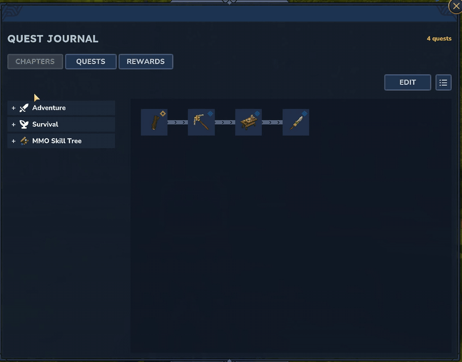
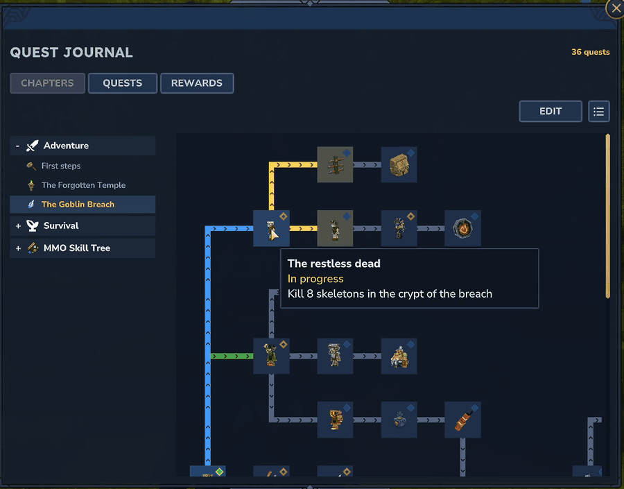
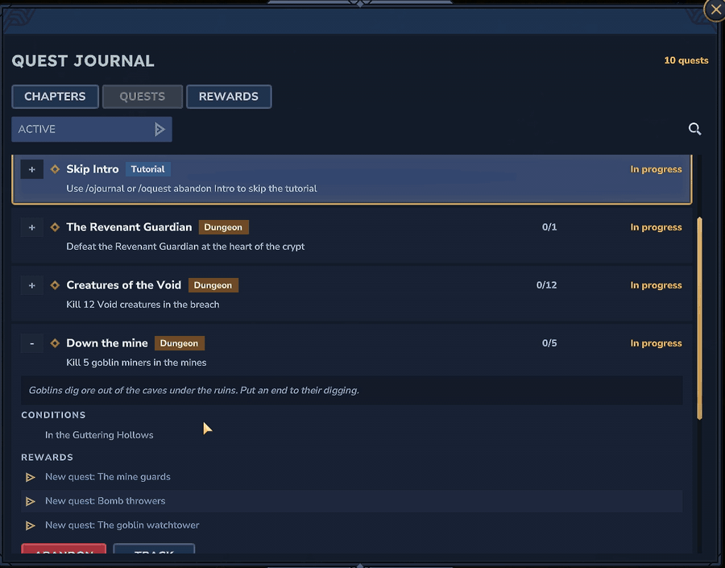
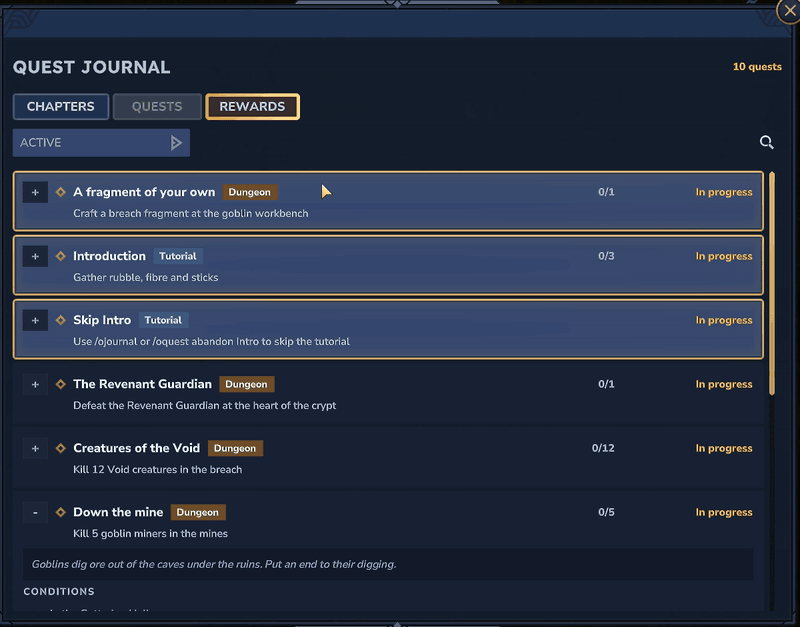
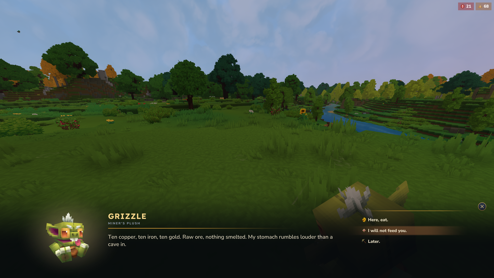
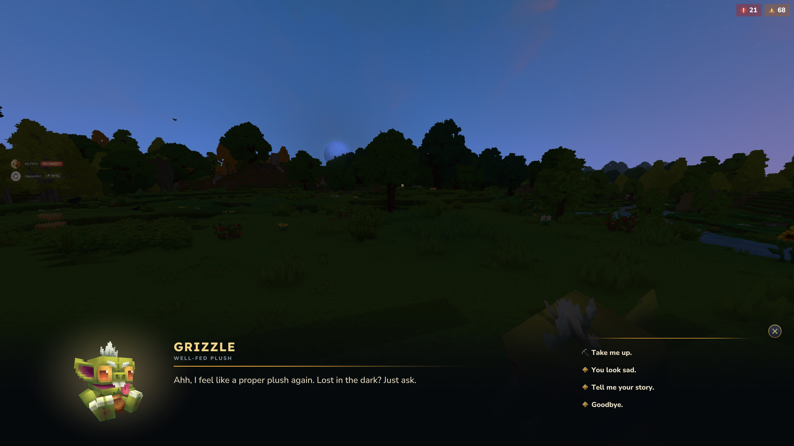

# Hytale Adventure Quests

📦 **Quests, characters and dialogues that bring vanilla Hytale to life. Install it, play it, delete it.**

Vanilla Hytale leaves you wondering what to do next. This pack gives you goals: a campaign through the Goblin Breach, a trial in the Forgotten Temple, characters who remember you, and feats for every way you move. It runs on OpenQuests, which installs with an empty quest list on purpose.

 

---

## ✨ What is inside

Over sixty quests in eight chapters, in English and French. A whole campaign through the Goblin Breach, a trial inside the Forgotten Temple, a tutorial, a hunt, a daily chore, a server event, a talking plush and a few secrets.

🖼️ **Every quest has its icon**, from a crude hatchet to the breach's portal key, so the journal and its chapter graphs read at a glance.

📝 **Two texts per quest.** The HUD shows a short line saying exactly what to do: *Kill 3 skeleton knights in the crypt*. The journal keeps the lore: *Armoured knights bar the way to the deepest tombs. Break through.*

---

## ⚔️ Adventure

### 🪓 First steps

🔀 **Introduction** asks for your first sticks, fibre and rubble, or lets you take the other way out: **Skip Intro** completes the moment you abandon the tutorial, for players who would rather get on with it.

⛓️ **Then a chain that hands itself along.** Tools, a workbench, then **Choose your weapon**: four crude weapons, any one of which ends it.

### 🏛️ The Forgotten Temple

💀 **Defeat the Guardian** fails the moment you die, and hands itself straight back: try again. Then enter the temple and **talk to the merchant**, which only counts inside.

⏱️ **The Temple's trial** gives you three minutes to run to the rune altar, sprint-jump ten times there, run for 20 seconds and explore for a minute. Leaving the temple or dying fails the whole trial.

🏅 **Flawless** stays a secret until you pass the trial without ever having failed it.

🕯️ **An offering** follows: throw ten Essence of Life at the foot of the altar. Picking one back up to throw it again does not count twice.

👥 **The temple has its people**, one of each for the whole server:

* 🌱 **A curious seedling** who has never been outside wants feathers, then crystal shards of every colour, and pays in
  trinkets he pilfered from the elders and the goblins.
* 🦌 **An enchanted stag** with a strange gaze eats the seeds you bring. As they get rarer, he sheds a hide more precious each time.
* 😟 **A young Kweebec** tells you about the goblin lab and its broken generator, and sends you looking for scrap.
* 🔧 **The goblin scientist** runs the lab repairs and wants a report after each: the gateway to the breach, the teleporter, the boiler, the engine, the compressor.
  Talk to her before she leaves.
* 🛡️ **A dreaming guard** wants to hear how you beat each boss of the breach, then to see a rune you forged, and sends
  you back through with a fragment.

### 🕳️ The Goblin Breach

Thirty-six quests across the Guttering Hollows, the pocket world a Goblin Breach portal opens on. The chapter graph lays them out by region, and every link shows what leads where.

🚪 **Through the breach** starts on its own the first time you step through, and opens five branches at once.

⚰️ **The crypt.** Skeletons, then their knights, then the **Revenant Guardian**, who hands the fight straight back if you die. Its rune shards make a fire rune.

⛏️ **The mines.** Goblin miners, shielded guards, the **Glutton** ruling the slums, lobbers raining bombs, and their boom powder turned into bangsticks.

🕸️ **The spider tunnels.** Cave spiders, goblin burners, silk for a scrap hook and a hookshot. **Purge the nest** asks for 25 spiders in a single trip: leave the breach and it starts over.

🟣 **The Void.** Void creatures, anomaly crystals to shatter, the keystone at the heart of a large underground anomaly, and the crystals it leaves behind for gadget assemblies.

🗼 **The watchtowers.** Stone, goblin or overgrown by the Void: climb them floor by floor, with a reward on every landing and another at the top.

🐻 **The Voidtaken Grizzly** gives its hide to the breach's finest gadgets: rocket boots and a scrap glider.

🗝️ **The veilbound coffer.** Free the Void spawn sealed in crystal, take its key, and open the coffer while every goblin in earshot comes running. Then pick your treasure: gadget assemblies, Void crystals or greater health potions.

🗓️ **The day's cull** is shared by every breach on the server: fifty goblins a day, all players together, renewed every day. It pays a random prize, sometimes a fresh breach fragment.

### 🧸 The strange plush

Five quests told entirely through dialogues, with no NPC at all: the chapter that shows off **OpenDialogues**.

⛏️ **First veins.** Strike copper, iron and gold, and a goblin plush turns up in your pocket.

👂 **A voice in the pocket.** Use it and it rustles in gibberish. Ask what that was, and **Grizzle** introduces itself over several pages: a miner's plush, left behind when the breach swallowed its camp.

🍽️ **Miner's appetite.** Grizzle wants ten copper, ten iron and ten gold ore. *Here, eat.* only shows once your bag holds all thirty, and takes them in one go. Wave gold under its nose before that and it sniffs at it. Refuse to feed it and the quest is abandoned on the spot.

⬆️ **Well fed, it changes its tune.** A new title, new answers, and a way back to the surface whenever you are lost underground. Its story waits behind an answer that remembers you already heard it. Now and then you find it asleep, mumbling about gold.

🏠 **Homesick, then Home at last.** It sighs for the goblin hills. Carry it through a Goblin Breach and tell it, there, that it is home.

📝 **Every dialogue feature in one story.** Pages, speakers and portraits, the cinematic and chat displays, coloured answers with icons, answers that hide until they make sense, lines picked by quest state or at random, and dialogues that hand out, complete or abandon quests through the **OpenQuests Dialogues** bridge.

---

## 🌿 Survival

### 🍖 Hunting

🥩 **Gather meat** is handed to every player and shown to nobody. The first raw meat you pick up, of any kind, completes it, and the chain appears out of nowhere: a campfire, cooked meat, then a meal that pays an Iron Hand Crossbow and 32 arrows.

### 🌲 Woodcutting

🪵 **Lumberjack** counts the trunks you bring back from your fellings, and leaves out the ones you threw.

🪓 **The Great Felling** is a server event launched by an admin: five hundred trunks felled by the whole server, counting only while two players are online, before a closing date. A trunk placed and felled again counts once.

### 🧺 Daily life

🫐 **Garden chores** asks for wild berries, five flowers and a wooden chest opened. It comes back at your next connection once the last one ended, at most once every twenty hours and seven times in all, and the journal counts down both.

---

## 🏆 Feats

🏃 **Athletics:** three quiet chains of three, **run**, **sprint** and **jump**, each a secret until you cover the first distance. Then the next rung waits in the journal, ten times further. **Silent step** does the same at a walk.

🗡️ **Combat:** **First blood** waits for your first duel.

---

All twenty-two quest types are in there, along with every constraint, the four scopes, all five reward types including rewards for failing, the three visibility modes, categories and chapters.

⛏️ Running **MMO Skill Tree**? The **[OpenQuests MMOSkillTree](https://www.curseforge.com/hytale/mods/openquests-mmoskilltree)** plugin brings a chapter of its own, *The prospector's path*, from a first bit of XP to Mining mastery.

---

## 🎯 Three ways to use it

🎮 **As a demo.** Install it, join, and the tracker fills up on its own.

📝 **As a worked example.** The assets are plain JSON. Open them in the Asset Editor beside the documentation and copy the shapes you need.

🚀 **As a starting point.** Edit the chains into your own, or delete the pack and start from an empty quest list. Nothing else depends on it.

---

## 🛠️ Installing

Requires **OpenQuests**, whose quest types these assets are written against, and which pulls in **OpenQuests Core** in turn.

This pack carries no code of its own. Drop the zip in `mods/`, and remove it whenever you want the quest list back to empty.

---

**Source and documentation:** https://github.com/MartelStudios/OpenQuests

MIT licensed.
