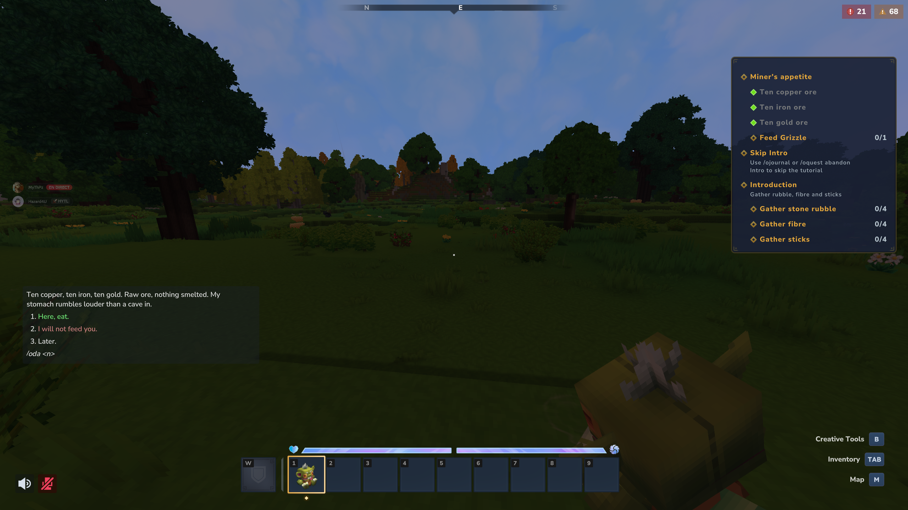

# OpenQuests Dialogues

💬 **Quests and dialogues that talk to each other: send players to speak with someone, hand out quests from an answer,
and let a character greet players by their quest progress.**

Install it next to OpenQuests and OpenDialogues. Players get quests from the people they talk to, and their answers
can finish them. Works in multiplayer and singleplayer, on new or existing worlds.

[](https://discord.gg/vtgfpA9nPQ) [](https://github.com/MartelStudios/OpenQuests)



***

## ✨ What you get

### 🎯 Two quest types

🗣️ **Talk to someone** (`Dialogue`): asks the player to open a dialogue, or to pick one of its answers, a number of times. "Talk to the
merchant" or "Agree to help the blacksmith" is one quest, usable as a step of any chain. With `"UseHistory": true`,
what the player said before getting the quest counts too.

🎁 **Bring them something** (`Deliver`): asks the player to bring items to a character. While the quest runs, F on that character opens the
delivery, your own dialogue or a generated one, and items can be handed over a few at a time.

👥 **Aimed at a character.** Both quest types can name an OpenDialogues character instead of a dialogue: "talk to the
village mage" works whichever NPC became the mage. A quest aimed at a character unique for the whole server fails on
its own if that character is lost for good.

🗺️ **On the map.** While such a quest runs, its character shows on the map with a "to turn in" mark, and on the compass
while the quest is tracked.

### 🎬 Answer actions

📜 **Hand out a quest** (`AssignQuest`): named by id or written right there in the dialogue. The quest's own rules
still apply, so a daily quest stays daily.

🏁 **End a quest** (`SetQuestState`): as completed, failed or abandoned, rewards included, as if the player had
played it to the end.

### 🔍 A dialogue condition

🔒 **Check a quest** (`RequiresQuest`): holds while one of the player's quests stands as asked: running, done, failed, or never taken.
Put it on an answer to show it only to the right players, or in a router so a character greets them according to
their progress.

```json
{
  "Text": "mypack.blacksmith.help",
  "When": { "Type": "RequiresQuest", "QuestAssetId": "MyPack_Blacksmith", "Not": true },
  "Actions": [
    { "Type": "AssignQuest", "Quest": "MyPack_Blacksmith" },
    { "Type": "Close" }
  ]
}
```

### 🧸 An example to start from

*The strange plush* chapter of
**[Adventure Quests](https://www.curseforge.com/hytale/mods/adventure-quests)** uses all of it: a goblin plush
that hands you its quest when you first talk to it, asks to be fed ore, and has new things to say once its belly is
full.

***

## 🛠️ Installing

Requires **OpenQuests** and **OpenQuests Core** 5.1.0 or newer, and **OpenDialogues** 2.0.0 or newer. CurseForge
installs them with it; by hand, drop them all in `mods/`.

***

**Source and documentation:** [https://github.com/MartelStudios/OpenQuests](https://github.com/MartelStudios/OpenQuests)

MIT licensed.
