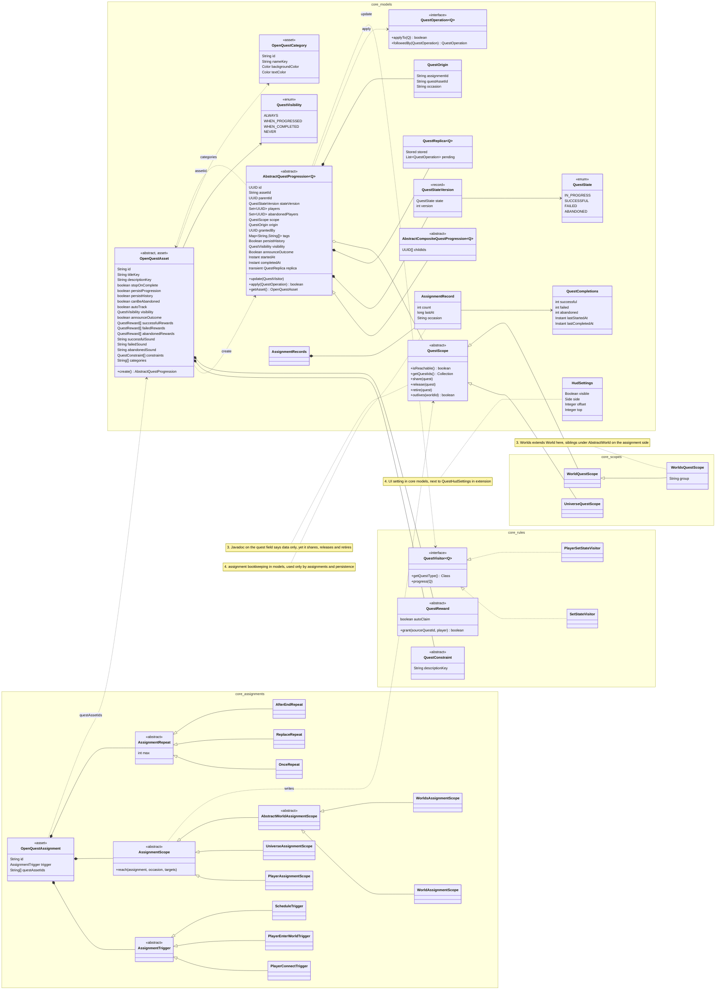

# OpenQuests model

Class diagrams of the quest model, split by module. Fields are the persisted ones; services,
systems, renderers and features are left out. Notes in red point at the inconsistencies listed at
the end.

## Core

## Extension

Core base classes appear as stubs. Each quest type is an asset and a progression; the visitor
that moves it is shown where it is shared.

```mermaid
classDiagram
    direction LR

    namespace core {
        class OpenQuestAsset {
            <<abstract, asset>>
        }
        class AbstractQuestProgression~Q~ {
            <<abstract>>
        }
        class AbstractCompositeQuestProgression~Q~ {
            <<abstract>>
        }
    }

    namespace extension_quantity {
        class QuantityQuestAsset {
            <<abstract>>
            int targetQuantity
        }
        class QuantityQuestProgression~Q~ {
            <<abstract>>
            int quantity
            Integer targetQuantity
        }
        class QuestItemFilter {
            String itemId
            String blockTag
            String resourceTypeId
        }
    }

    namespace extension_items {
        class ItemExchangeQuestAsset {
            <<abstract>>
            boolean antiAbuse
        }
        class ItemExchangeQuestProgression~Q~ {
            <<abstract>>
        }
        class DropItemQuestAsset {
            QuestItemFilter itemToDrop
        }
        class DropItemQuestProgression {
            QuestItemFilter itemToDrop
        }
        class PickupItemQuestAsset {
            QuestItemFilter itemToPickup
        }
        class PickupItemQuestProgression {
            QuestItemFilter itemToPickup
        }
        class GatherQuestAsset {
            QuestItemFilter itemToGather
        }
        class GatherQuestProgression {
            QuestItemFilter itemToGather
        }
        class CastSpellQuestAsset {
            QuestSpellFilter spellToCast
        }
        class CastSpellQuestProgression {
            QuestSpellFilter spellToCast
        }
        class ConsumeItemQuestAsset {
            QuestItemFilter itemToConsume
        }
        class ConsumeItemQuestProgression {
            QuestItemFilter itemToConsume
        }
        class CraftQuestAsset {
            QuestItemFilter itemToCraft
        }
        class CraftQuestProgression {
            QuestItemFilter itemToCraft
        }
        class InteractivelyPickupQuestAsset {
            QuestItemFilter itemToPickup
        }
        class InteractivelyPickupQuestProgression {
            QuestItemFilter itemToPickup
        }
    }

    namespace extension_blocks {
        class BlockActionQuestAsset {
            <<abstract>>
            boolean antiAbuse
        }
        class BlockActionQuestProgression~Q~ {
            <<abstract>>
        }
        class BreakBlockQuestAsset {
            QuestItemFilter blockToBreak
        }
        class BreakBlockQuestProgression {
            QuestItemFilter blockToBreak
        }
        class PlaceBlockQuestAsset {
            QuestItemFilter blockToPlace
        }
        class PlaceBlockQuestProgression {
            QuestItemFilter blockToPlace
        }
        class UseBlockQuestAsset {
            QuestItemFilter blockToUse
        }
        class UseBlockQuestProgression {
            QuestItemFilter blockToUse
        }
    }

    namespace extension_movement {
        class MovementQuestProgression~Q~ {
            <<abstract>>
            double pending
        }
        class TravelQuestAsset {
            <<abstract>>
            Measure measure
        }
        class TravelQuestProgression~Q~ {
            <<abstract>>
        }
        class WalkQuestAsset
        class WalkQuestProgression
        class RunQuestAsset
        class RunQuestProgression
        class SprintQuestAsset
        class SprintQuestProgression
        class JumpQuestAsset
        class JumpQuestProgression {
            boolean wasJumping
        }
    }

    namespace extension_kill {
        class KillNpcQuestAsset {
            String npcGroupId
        }
        class KillNpcQuestProgression {
            String npcGroupId
        }
        class KillPlayerQuestAsset {
            String playerToKill
        }
        class KillPlayerQuestProgression {
            String playerToKill
        }
    }

    namespace extension_other {
        class CompositeQuestAsset {
            String[] assetIds
            Operator operator
            boolean persistChildrenHistory
        }
        class CompositeQuestProgression {
            Map childOutcomes
            Map childVersions
        }
        class EnterWorldQuestAsset {
            WorldNamePattern worldNamePattern
        }
        class EnterWorldQuestProgression {
            WorldNamePattern worldNamePattern
        }
        class ReachLocationQuestAsset {
            Vector3d position
            double radius
        }
        class ReachLocationQuestProgression
        class QuestStateQuestAsset {
            String questAssetId
            QuestStateRequirement questStateRequirement
            boolean not
        }
        class QuestStateQuestProgression {
            String questAssetId
            QuestStateRequirement questStateRequirement
        }
        class NoOpQuestAsset
        class NoOpQuestProgression
    }

    OpenQuestAsset <|-- QuantityQuestAsset
    AbstractQuestProgression <|-- QuantityQuestProgression
    AbstractQuestProgression <|-- AbstractCompositeQuestProgression

    QuantityQuestAsset <|-- ItemExchangeQuestAsset
    QuantityQuestProgression <|-- ItemExchangeQuestProgression
    ItemExchangeQuestAsset <|-- DropItemQuestAsset
    ItemExchangeQuestProgression <|-- DropItemQuestProgression
    ItemExchangeQuestAsset <|-- PickupItemQuestAsset
    ItemExchangeQuestProgression <|-- PickupItemQuestProgression
    QuantityQuestAsset <|-- GatherQuestAsset
    QuantityQuestProgression <|-- GatherQuestProgression
    QuantityQuestAsset <|-- ConsumeItemQuestAsset
    QuantityQuestProgression <|-- ConsumeItemQuestProgression
    QuantityQuestAsset <|-- CastSpellQuestAsset
    QuantityQuestProgression <|-- CastSpellQuestProgression
    QuantityQuestAsset <|-- CraftQuestAsset
    QuantityQuestProgression <|-- CraftQuestProgression
    QuantityQuestAsset <|-- InteractivelyPickupQuestAsset
    QuantityQuestProgression <|-- InteractivelyPickupQuestProgression

    QuantityQuestAsset <|-- BlockActionQuestAsset
    QuantityQuestProgression <|-- BlockActionQuestProgression
    BlockActionQuestAsset <|-- BreakBlockQuestAsset
    BlockActionQuestProgression <|-- BreakBlockQuestProgression
    BlockActionQuestAsset <|-- PlaceBlockQuestAsset
    BlockActionQuestProgression <|-- PlaceBlockQuestProgression
    QuantityQuestAsset <|-- UseBlockQuestAsset
    QuantityQuestProgression <|-- UseBlockQuestProgression

    QuantityQuestProgression <|-- MovementQuestProgression
    QuantityQuestAsset <|-- TravelQuestAsset
    MovementQuestProgression <|-- TravelQuestProgression
    TravelQuestAsset <|-- WalkQuestAsset
    TravelQuestProgression <|-- WalkQuestProgression
    TravelQuestAsset <|-- RunQuestAsset
    TravelQuestProgression <|-- RunQuestProgression
    TravelQuestAsset <|-- SprintQuestAsset
    TravelQuestProgression <|-- SprintQuestProgression
    QuantityQuestAsset <|-- JumpQuestAsset
    MovementQuestProgression <|-- JumpQuestProgression

    QuantityQuestAsset <|-- KillNpcQuestAsset
    QuantityQuestProgression <|-- KillNpcQuestProgression
    QuantityQuestAsset <|-- KillPlayerQuestAsset
    QuantityQuestProgression <|-- KillPlayerQuestProgression

    OpenQuestAsset <|-- CompositeQuestAsset
    AbstractCompositeQuestProgression <|-- CompositeQuestProgression
    OpenQuestAsset <|-- EnterWorldQuestAsset
    AbstractQuestProgression <|-- EnterWorldQuestProgression
    OpenQuestAsset <|-- ReachLocationQuestAsset
    AbstractQuestProgression <|-- ReachLocationQuestProgression
    OpenQuestAsset <|-- QuestStateQuestAsset
    AbstractQuestProgression <|-- QuestStateQuestProgression
    OpenQuestAsset <|-- NoOpQuestAsset
    AbstractQuestProgression <|-- NoOpQuestProgression

    note for GatherQuestProgression "1. instance override of the asset parameter, ignored by the default title"
    note for ReachLocationQuestProgression "1. no instance override"
    note for JumpQuestAsset "2. no MovementQuestAsset: asset and progression trees diverge"
    note for UseBlockQuestAsset "2. a block action outside BlockAction"
    note for GatherQuestAsset "2. item quests split between ItemExchange and Quantity"
    note for KillNpcQuestAsset "2. NPC and player kills share a death system, not a base"
```

## Inconsistencies

1. **Instance overrides of asset parameters, unevenly honoured.** Thirteen types let an instance
   override its asset's parameter (`itemToGather`, `npcGroupId`, `playerToKill`...), and every
   counted quest its `targetQuantity`, so that a script can hand out a quest generated from a
   template asset (a daily bounty board, say). Nothing writes them yet, and they fall short of that
   use:
   - `getDefaultTitle` reads the asset's value, not the instance's, and kill player has no default
     title at all, so a generated quest reads the same as its template.
   - `ReachLocation`, `Travel` and `Composite` take no override; rewards, title and description
     cannot be overridden at all (`QuestRewardService` reads the asset's rewards).
   - The setters write the field directly: set after registration, the change is never marked
     dirty, and on a quest other servers write too it is never written at all. They hold only
     before registration, like `setPersistHistory`, but nothing says or checks so.
2. **Asset and progression trees do not mirror each other.** `JumpQuestProgression` sits under
   `MovementQuestProgression`, `JumpQuestAsset` straight under `QuantityQuestAsset`. Block quests:
   break and place share `BlockAction`, use does not. Item quests: drop and pickup share
   `ItemExchange` (anti-abuse), gather, consume, craft and interactive pickup do not, although all
   six filter on a `QuestItemFilter`. Kill NPC and kill player share a death system and no base.
3. **Two parallel scope hierarchies of different shapes.** `QuestScope` (in `models`, subclasses in
   `scopes`) and `AssignmentScope` (in `assignments.scope`) both model universe, world and group of
   worlds, but `WorldsQuestScope extends WorldQuestScope` while the assignment side has two
   siblings under `AbstractWorldAssignmentScope`, and only the assignment side has a player scope.
   The quest's `scope` field is documented as data only, yet `QuestScope` shares, releases and
   retires quests.
4. **`models` mixes the quest model with player bookkeeping.** `QuestCompletions`,
   `AssignmentRecord(s)` and `HudSettings` are per-player records stored in `QuestStoreComponent`.
   `AssignmentRecord(s)` is only used by `assignments` and `persistence`; `HudSettings` is a UI
   setting in core while `QuestHudSettings` lives in the extension.
5. **Two ways to move a quest.** A `QuestVisitor` per type, often a thin wrapper around `apply`,
   and `QuestOperation`. The visitor is not a GoF visitor (no double dispatch) but a command typed
   by quest class. Families share one (`BlockActionVisitor`, `ItemExchangeVisitor`,
   `MovementQuestVisitor`), every other type has its own, gather and consume included although
   they would fit the item family.
6. **Naming.** `GatherEvents` next to `CompositeQuestEvents` and `EnterWorldQuestEvents`;
   `*EventSystem`, `*Systems`, `*DeathSystem` for the same role; validators only for composite and
   enter world.
